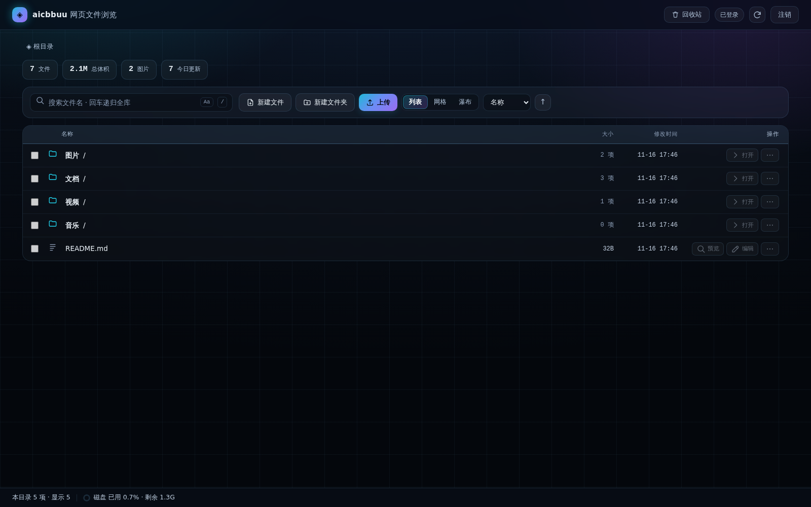
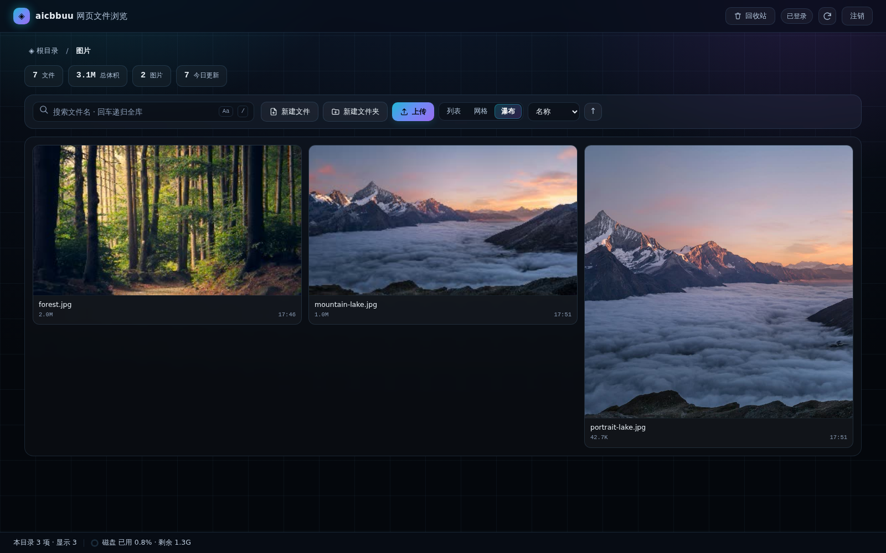

# aicbbuu网页文件浏览

> 把电脑上的一个文件夹变成网页 —— 同一局域网里，手机、平板、另一台电脑，打开浏览器就能浏览、上传、下载、编辑。**零依赖，纯本地，不用装数据库也不用配 nginx。**

你有没有这种时候：

- 想把同事电脑上的文件拷过来，但没 U 盘也没有云盘
- 在家里的电脑上下了一个电影，想在客厅用平板看
- 手机拍了照片，想存到电脑的某个文件夹里
- 身边只有浏览器，却想管理远端机器上的文件

把它在一台电脑上跑起来，同网络下所有设备都能操作。

---

## 它能干什么

| 功能 | 说明 |
|---|---|
| 📂 **浏览文件** | 列表 / 网格 / 瀑布流三种视图，目录显示子项数和总大小 |
| ⬆️ **上传文件** | 拖拽或点选，从手机/平板/其他电脑直接传上来 |
| ⬇️ **下载文件** | 单个下载，或多选打包成 zip |
| 🖼 **在线预览** | 图片、视频、音频、PDF、网页直接在灯箱里看，不用下载 |
| ✏️ **在线编辑** | 文本、代码、Markdown 直接改，改完即生效 |
| 🗂 **文件管理** | 新建 / 重命名 / 复制 / 剪切 / 删除(移入回收站) |
| 🔗 **路径链接** | 行内一键复制文件直达地址，中文路径保持可读 |
| 🗑️ **回收站** | 删除先进回收站，30 天内随时还原，不怕手滑 |
| 🔍 **搜索** | 既能搜文件名，也能搜文件内容（带命中行） |
| 🕘 **编辑历史** | 每次保存留一版（每文件 20 版），改错了能翻回去 |
| 🔗 **分享链接** | 给单个文件生成免登录只读链接，可设 1/7/30 天有效期，随时撤销 |
| 📊 **概览数据** | 顶部显示文件数、总体积、图片数、今日更新 |
| ⌨️ **快捷键** | `Ctrl+K` 命令面板，键盘操作一切 |
| 🔒 **密码保护** | 登录才能进，密码只存哈希，失败自动限速 |
| 🎨 **深空玻璃界面** | 深色科技风，用久了眼睛不累 |

适合你：

- 办公室共享文件，不想搭 FTP 或网盘
- 家庭局域网共享媒体、文档
- 临时传文件，跑起来用完就关

---

## 界面长这样

主界面：文件列表 + 顶部概览 + 所有操作一屏搞定。



图片视图（瀑布流，按原比例排布，不会加载完跳版）：



---

## 为什么用它

- 🐍 **零依赖** —— 只需要 Python 3.8+，不装任何第三方库，离线可用
- ⚡ **超轻量** —— 内存十几 MB，老电脑、树莓派都能跑
- 🔒 **纯本地** —— 数据只在你自己的机器上，不上传任何云
- 🛡 **安全** —— 密码只存哈希、登录限速、路径穿越防护、会话 HttpOnly + Secure
- 🔐 **可选 HTTPS** —— 安装时自动生成自签证书，局域网内加密传输
- 🎯 **服务化安装** —— 一条命令装成 systemd 服务，开机自启，崩了自动拉起

---

## 怎么用

### 方式一：直接开跑（最快，适合先试试）

找一台有 Python 3.8+ 的机器，在项目目录运行：

```bash
RESOURCE_PASSWORD='你的登录密码' python3 web_file_browser.py
```

然后用浏览器打开 `http://这台机器的IP:443`。

默认账号 `admin`，密码是你刚才设的那个。

> 不设 `RESOURCE_PASSWORD` 会拒绝启动 —— 程序不内置任何默认口令。

### 方式二：装成系统服务（推荐，开机自启）

```bash
sudo bash install.sh
```

脚本会问你几件事（共享目录、端口、账号、密码、是否生成证书），然后：

- 复制程序到 `/opt/web-file-browser`
- 生成自签 HTTPS 证书
- 装好 systemd 服务，**用你的普通用户身份运行**（不是 root）
- 开机自启、崩溃自动重启

装完直接打开 `https://这台机器的IP/`。

想卸载：

```bash
sudo bash uninstall.sh
```

> 卸载**不会**删你的文件目录和配置文件。

---

## 端口与 HTTPS

默认端口 **443** —— 局域网里直接 `https://<IP>/` 就能打开，不用记端口号。

两点要知道：

1. **443 是特权端口**，普通用户绑不上。`install.sh` 会用 systemd 的
   `AmbientCapabilities=CAP_NET_BIND_SERVICE` 单独授权这一项能力，
   程序本身仍然是普通用户权限（不能随便动系统文件）。
2. **443 可能被占用**。如果机器上已经跑着 nginx/apache，装的时候会启动失败，
   脚本会提示你换端口：

   ```bash
   sudo ss -tlnp | grep ':443 '
   ```

   重新 `sudo bash install.sh`，端口填 `8443` 之类即可。

**关于自签证书**：安装时生成的证书浏览器不认，首次访问会提示「不安全」。
点「继续前往」就能用。想彻底消除警告，把 `/opt/web-file-browser/certs/server.crt`
导入系统的受信任根证书即可；也可以换成你自己的正式证书，改配置里的
`RESOURCE_TLS_CERT` / `RESOURCE_TLS_KEY` 指过去。

**不想要 HTTPS**？安装时选「不生成证书」，程序会自动降级成纯 HTTP，不会启动失败。

---

## 配置项

全部通过环境变量控制。装了服务的话，配置在 `~/.config/web-file-browser.env`（权限 600）。
改完重启服务生效：`sudo systemctl restart web-file-browser`。

| 变量 | 默认 | 说明 |
|---|---|---|
| `RESOURCE_PASSWORD` | **无，必填** | 登录密码。不设就拒绝启动 |
| `RESOURCE_USER` | `admin` | 登录账号 |
| `RESOURCE_DIR` | `~/resource` | 要共享出去的目录 |
| `RESOURCE_PORT` | `443` | 监听端口 |
| `RESOURCE_HOST` | `0.0.0.0` | 监听地址（只给自己用改 `127.0.0.1`） |
| `RESOURCE_TLS` | `1` | 是否启用 HTTPS（`0` 关） |
| `RESOURCE_TLS_CERT` | `certs/server.crt` | 证书路径 |
| `RESOURCE_TLS_KEY` | `certs/server.key` | 私钥路径 |
| `RESOURCE_DATA_DIR` | `data/` | 会话 / 分享 / 回收站 / 历史数据放哪 |

完整样例见 [`.env.example`](.env.example)。

---

## 目录结构

```
web_file_browser.py      入口：HTTP/HTTPS 服务、路由、认证
app/
  config.py              所有配置常量与环境变量
  auth.py                会话存储、登录限速
  files.py               路径安全、目录列表、搜索、缩略图、回收站
  upload.py              流式 multipart 上传
  views.py               页面渲染
  share.py               分享链接
  history.py             编辑历史
templates/               页面模板
static/                  CSS / JS / SVG 图标
data/                    运行时数据（会话、分享、回收站、历史）— 自动创建
thumbs/                  缩略图缓存 — 自动创建
certs/                   证书 — 安装时生成
```

运行时目录 `data/` `thumbs/` `certs/` 都不进 git。

---

## 常见问题

**Q：能在外网访问吗？**
不建议。这是给局域网设计的工具。非要外网用，请自己套反向代理并配好 TLS，别把端口直接暴露到公网。

**Q：支持多少文件？**
测试过 1500+ 个文件的目录，列表分页、缩略图缓存都正常。再大的库也能跑，只是首屏慢一点（缩略图是懒加载的）。

**Q：删除的文件去哪了？**
进回收站，保留 30 天，可在界面里还原或彻底删除。因为删除只是移入回收站、随时能还原，
所以**点删除不弹确认框**；回收站里彻底删除才会二次确认。彻底删除时会连编辑历史一起清掉。

**Q：分享链接安全吗？**
链接里带随机 token，拿到链接的人可以只读访问那一个文件。可设 1/7/30 天有效期，也能随时撤销。
**不要分享给不该看到的人** —— token 本身就是凭证。

**Q：上传大文件会卡住吗？**
不会。上传走临时文件流式处理，不会把整个文件读进内存。打包下载同理。

**Q：手机上能用吗？**
能。界面做了窄屏适配，手机上会自动切换成紧凑布局。

---

## 遇到问题 / 想反馈

遇到 BUG、装不上、或者有功能建议，到 Issues 页留言：

👉 **https://github.com/aicbbuu/aicbbuu-web-file-browser/issues**

反馈时最好带上：

- 你的系统（发行版 / 版本）、Python 版本
- 怎么复现的
- 期望什么 vs 实际什么
- 报错日志：`sudo journalctl -u web-file-browser -n 50`

**请别把密码贴进去。**

---

## 版本历史

- **v2.0.1** —— 新增「已分享」入口：顶栏可查看、复制、撤销所有分享链接（之前只能创建，看不到自己分享过什么）；`Ctrl+K` 命令面板同步加入口；界面截图更新。
- **v2.0.0** —— 完整重构：模块化架构；深空玻璃界面（列表 / 网格 / 瀑布流三视图）；回收站（30 天可还原）；分享链接（有效期 + 可撤销）；编辑历史（每文件 20 版）；文件名 + 全文双模搜索；`Ctrl+K` 命令面板；39 个线性 SVG 图标；缩略图缓存；流式上传与大目录打包；可选 HTTPS（默认 443，自签证书）；一条命令装成 systemd 服务。
- **v1.0.0** —— 首个发布：网页浏览、上传、下载、在线编辑、文件管理、批量打包下载、大目录分页、重名提示、登录限速、多线程、深色界面。

---

## 许可

本项目基于 **GNU GPL-3.0** 许可证开源（见 [`LICENSE`](LICENSE)）。
你可以自由使用、修改、分发，但衍生作品也必须以 GPL-3.0 开源。
